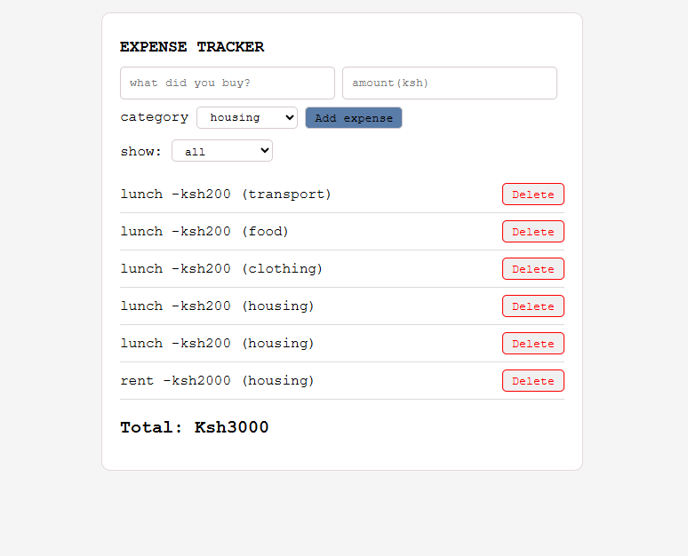

# EXPENSE TRACKER

The tool helps one track their finances by adding or deleting your expenses to view how much money is being used and what it's being used for 

[Live demo of the tool](https://johnny-church.github.io/expense-tracker/)

## Features
 - It adds and deletes expenses
 - Filters by category 
 - Shows the total
 - Saves data between visits

## Built with
 Javascript, html and css

## What i learnt
 I learnt the workings of github , local storage, map,filter, reduce, DOM ,events , saving to storage, working with branches( creating , merging , deleting)

## Next ideas for the project 
- I'd like to add an income section that one can input the amount of money they have , cross reference it with the expenses to give the amount remaining,
- Also monthly summaries 